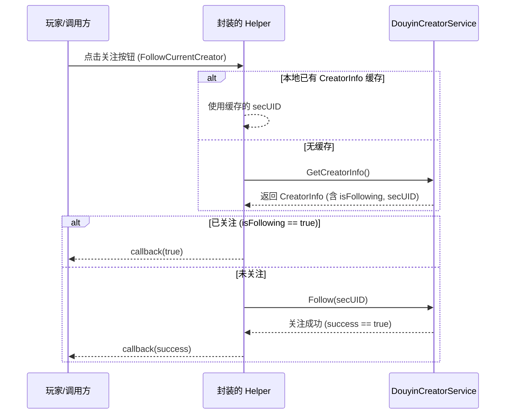

# 创作者服务 - Lua

> 本篇带你从 0 到 1 用 Lua 实现创作者关注链路：获取当前创作者信息 → 关注 → 打开主页，并封装缓存 / 并发 / 容错。
> 若需求是“靠近提示牌点击关注”，可把下面的 helper 接到基础交互按钮的点击回调里（按钮生命周期见基础交互相关文档）。

---

## 一、何时使用

- 获取当前场景创作者昵称、头像、粉丝数或关注态。
- 关注当前创作者、打开当前创作者主页。
- 在任意业务入口中执行“关注后打开主页”“关注成功后发奖励 / Toast”等组合。

---

## 二、调用时序

一个典型的“点击 → 获取信息 → 关注 → 关注成功回调”的时序如下：



---

## 三、最小化 helper（缓存 + 并发拦截 + 容错）

把以下状态和 helper 放在脚本顶部公共区。调用方按自身流程调用 `FollowCurrentCreator` / `OpenCurrentCreatorInformation`，无需关心信息获取时序。

```lua
local UnityEngine = UnityEngine
local DouyinCreatorService = DouyinCreatorService
local DouyinUtility = DouyinUtility

local creatorInfo = nil
local creatorInfoRequesting = false
local pendingCreatorAction = nil
local creatorIsFollowing = false
local creatorFollowPending = false

-- 字段名是 secUID（UID 大写），且必须非空；不要猜成 secUid / openID
local function getCreatorSecUID(info)
  if info == nil or info.secUID == nil or info.secUID == "" then
    return nil
  end
  return info.secUID
end

-- 命中缓存则直接执行；否则发起一次 GetCreatorInfo，并用 requesting 拦截并发
local function runWithCreatorInfo(action)
  if action == nil then
    return
  end

  local cachedSecUID = getCreatorSecUID(creatorInfo)
  if cachedSecUID ~= nil then
    action(creatorInfo, cachedSecUID)
    return
  end

  pendingCreatorAction = action
  if creatorInfoRequesting then
    return
  end

  creatorInfoRequesting = true
  DouyinCreatorService.GetCreatorInfo(function(info)
    creatorInfoRequesting = false
    creatorInfo = info
    creatorIsFollowing = info ~= nil and info.isFollowing == true

    local readyAction = pendingCreatorAction
    pendingCreatorAction = nil

    -- 调试器模式下可能返回空：判空并提示，不继续后续调用
    local secUID = getCreatorSecUID(info)
    if secUID == nil then
      UnityEngine.Debug.LogWarning("DouyinCreatorService.GetCreatorInfo returned empty creator info")
      DouyinUtility.Toast("当前无法获取创作者信息")
      return
    end

    if readyAction ~= nil then
      readyAction(info, secUID)
    end
  end)
end

local function FollowCurrentCreator(onFinished)
  runWithCreatorInfo(function(info, secUID)
    -- 已关注直接视为成功，不重复调用 Follow
    if creatorIsFollowing or info.isFollowing then
      if onFinished ~= nil then
        onFinished(true, info, secUID)
      end
      return
    end

    -- pending 拦截重复点击
    if creatorFollowPending then
      return
    end
    creatorFollowPending = true

    -- Follow 是异步，只有 success == true 才代表关注成功
    DouyinCreatorService.Follow(secUID, function(success)
      creatorFollowPending = false
      if success then
        creatorIsFollowing = true
      end

      if onFinished ~= nil then
        onFinished(success, info, secUID)
      end
    end)
  end)
end

-- OpenCreatorInformation 是纯动作、无回调，不要写等待逻辑
local function OpenCurrentCreatorInformation()
  runWithCreatorInfo(function(_, secUID)
    DouyinCreatorService.OpenCreatorInformation(secUID)
  end)
end
```

如需“关注后打开主页”，由调用方在 `FollowCurrentCreator` 的 `success == true` 回调中再调用 `OpenCurrentCreatorInformation()`。

---

## 四、入口组合示例

### C 区按钮入口

按钮的完整生命周期（创建、显隐、销毁）见基础交互相关文档，此处按钮点击只需要调用平台服务 helper：

```lua
function OnInteractorButtonClick(index)
  if index ~= 1 or localActor == nil then
    return
  end

  FollowCurrentCreator(function(success)
    if success then
      DouyinUtility.Toast("关注成功")
    else
      DouyinUtility.Toast("关注失败")
    end
  end)
end
```

### 非交互入口

平台服务也可以从 Runtime UI event、任务完成回调或弹窗确认 callback 调用：

```lua
local function OnTaskRewardConfirmed()
  FollowCurrentCreator(function(success)
    if success then
      DouyinUtility.Toast("已关注作者")
    end
  end)
end
```

---

## 五、相关文档

- C# 版：[创作者服务 - C#](创作者服务-CSharp.md)
- Manual（概念、字段、边界、FAQ）：[创作者服务](../../Manual/Ⅴ.%20平台服务(Cloud%20Services)/平台业务服务/创作者服务.md)
- API Reference：[GetCreatorInfo](../../API%20Reference/DouyinCreatorService/DouyinCreatorService.GetCreatorInfo.md)、[Follow](../../API%20Reference/DouyinCreatorService/DouyinCreatorService.Follow.md)、[OpenCreatorInformation](../../API%20Reference/DouyinCreatorService/DouyinCreatorService.OpenCreatorInformation.md)、[CreatorInfo](../../API%20Reference/DouyinCreatorService/CreatorInfo.md)
