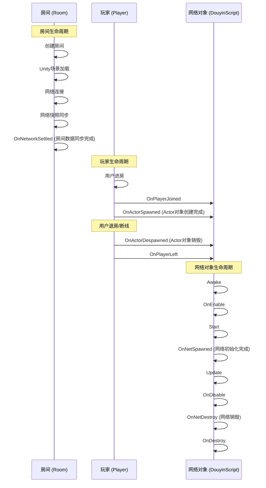

# 游戏对象的生命周期

游戏对象的生命周期分为三个并行层面：**房间生命周期**、**玩家生命周期**、**网络对象生命周期**。这三者是并行执行的，并不保证相互之间固定的调用顺序。

## 核心生命周期时序图

以下是世界核心生命周期事件的时序约束图：

## 生命周期解析

"生命周期"关键事件回调。生命周期存在三条并行的时序线：
| 时序线 | 关注对象 | 关键回调 |
| --- | --- | --- |
| 房间生命周期 | 整个房间 | `OnNetworkSettled`、`isNetworkSettled` |
| 玩家生命周期 | 玩家 + 玩家 Actor | `OnPlayerJoined / OnPlayerRejoined / OnPlayerLeft`、`OnActorSpawned / OnActorDespawned / OnActorRespawn` |
| 网络对象生命周期 | 网络对象 | 1. Unity 侧 `Awake / OnEnable / Start / Update / OnDestroy`；  2. 网络侧 `OnNetSpawned / OnNetDestroy` |
> ⚠️ **重要**：
> **网络对象生命周期与玩家生命周期是并行的，不保证顺序**；
> **对象的网络生命周期与 对象的Unity 生命周期是并行的，不保证顺序**；
> **同一玩家的** **`OnPlayerJoined` 一定早于该玩家的 `OnActorSpawned`**（唯一的顺序保证）。

---

### 1. 房间生命周期
* **流程**：房间创建 → Unity 场景加载 → 网络连接 → 数据快照同步 → 房间销毁。
* **相关事件回调**

| API | 返回 | 说明 |
| --- | --- | --- |
| `DouyinNetService.isNetworkSettled` | bool | 房间数据是否同步完成 |
| `DouyinNetService.OnNetworkSettled` | 事件 | 一次性事件；房间数据同步完成时触发 |

* **`DouyinNetService.isNetworkSettled`**：此标识为 `true` 时，代表本地数据与服务器已完全同步完成。在 Unity 生命周期（如 Awake/Start）调用网络相关 API（主权判定、发送消息）前，必须判断该值是否为 `true`。
  > **⚠️ 特别注意**：当场景中的静态网络对象触发 `OnNetSpawned()` 回调时，此时房间的数据快照仍在同步中，因此 `DouyinNetService.isNetworkSettled` 此时的值为 `false`。
* **`OnNetworkSettled` 事件**：全局仅触发一次的事件，适合用于处理必须等待网络同步完成后的客户端初始化逻辑。

### 2. 玩家生命周期
* **标准流程**：`OnPlayerJoined` → `OnActorSpawned` → (正常游玩) → `OnActorDespawned` → `OnPlayerLeft`。
* **相关事件回调**：

| 回调 | 触发时机 |
| --- | --- |
| `OnPlayerJoined(player, evt)` | 玩家进入房间。`evt`：`JoinRoom` 首次 / `RejoinRoom` 重连 |
| `OnPlayerRejoined(player)` | 玩家断线重连。若脚本定义了该回调，重连时**不再**触发 `OnPlayerJoined` |
| `OnActorSpawned(actor)` | 玩家 Actor 加载完成 |
| `OnActorRespawn(actor)` | Actor 重生 |
| `OnActorDespawned(actor)` | Actor 销毁；此时 `actor.douyinPet` 可能为 nil |
| `OnPlayerLeft(player, evt)` | 玩家离开。`evt`：`ExitRoom` 正常 / `Disconnect` 断线 |

* **时序保证**：同一玩家的 `OnPlayerJoined` **一定**在 `OnActorSpawned` 之前调用。
* **Actor 获取时机**：`DouyinActorService.GetLocalActor()` 需要在 `OnActorSpawned()` 之后，如果是合养精灵模式，需要用户携带精灵进入世界时，才会返回有效的 `DouyinActor` 对象，否则可能返回 `nil`。
* **断线与重连**：
  * 断线时：**不会**触发 `OnActorDespawned` 和 `OnPlayerLeft`，其他客户端和服务器都不感知该玩家的断线状态。
  * 重连时：会触发 `OnPlayerRejoined`（如果未定义则兼容触发 `OnPlayerJoined`，需开发者自行去重处理）。
  * 杀进程重进：玩家强制杀掉客户端进程后，即使快速返回之前的房间，也**不会**保留之前的精灵和游戏进度。
* **清理约束**：当玩家正常或异常退出触发 `OnActorDespawned` 时，客户端已断开与服务器的连接，**此时无法发送任何网络消息**（例如不能在此调用 `NetDestroy` 销毁对象）。此外，此时访问该玩家绑定的 `douyinPet` 将返回 `nil`。

### 3. 网络对象生命周期
* **双线并行**：对象的 Unity 原生生命周期（Awake -> Start）与网络生命周期（`OnNetSpawned`）并行，**不保证执行顺序**。任何同时依赖两者的逻辑，必须以两个回调都被触发过为前提。
* **业务逻辑本地与网络阶段分离**：
  * `Awake / Start` 属于**本地阶段**，此时网络环境尚未就绪。
  * 依赖同步状态、主权、其他玩家/对象的业务逻辑，以及同步变量的读取、`OnValueChange` 的注册，语义上均属于**网络阶段**，必须写在 `OnNetSpawned` 中，或在 `isNetworkSettled == true` 之后执行。
* **回调注册与反注册成对原则**：
  * `OnNetSpawned` 与 `OnNetDestroy` 必须成对。
  * `OnActorSpawned` 与 `OnActorDespawned` 必须成对。
  * 任一侧注册的监听，只在对侧存在期间有效，防止内存泄漏或野指针。
* **相关事件回调** 

| 回调 | 语义 |
| --- | --- |
| `Awake / OnEnable / Start` | Unity 原生；此时网络属性尚未就绪 |
| `OnNetSpawned` | 网络对象加载完成；同步变量的有效值从此刻起可读 |
| `OnValueChange(cur, prev)` | 同步变量变化 |
| `OnNetDestroy` | 网络对象销毁前 |
| `OnDestroy` | Unity 销毁；此时网络已断开 |
* **对象依赖解耦**：
  * 在 `OnNetSpawned` 中调用 `GetLocalActor()` 可能返回 `nil`（玩家 Actor 可能还没 Spawn）。
  * 在 `OnActorSpawned` 中获取网络对象也可能为空（对象可能还没 Spawn）。
* **同步变量初始化**：同步变量的有效值仅在 `OnNetSpawned` 之后才可被安全访问；如果需要在 `Awake` 中注册同步变量的 `OnValueChange` 回调，需注意回调触发时对象网络状态可能尚未初始化完成。
* **动态对象生成回调（NetSpawn）**：
  执行时序处于 `Awake` 之后，`Start` 与 `OnNetSpawned` 之前。适合在此处给新生成的对象同步变量进行初始赋值。该回调只在本地客户端运行，但在其中写入的同步变量值能同步到所有客户端。本端能否感知该同步变量的 `OnValueChange`，取决于其注册时机：注册在 `Awake` 中能触发，注册在 `Start / OnNetSpawned` 中不触发。