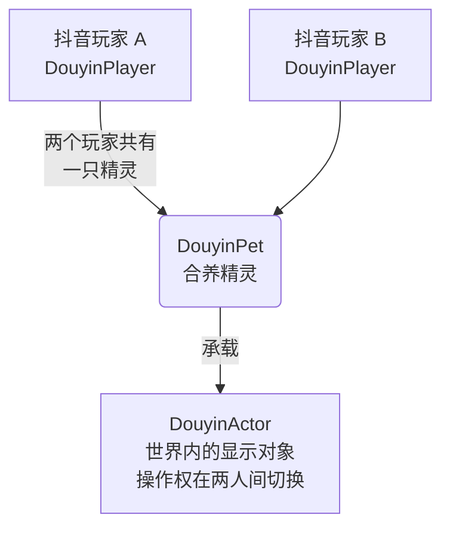

# 合养精灵 (Pet) 模式

在 Hamlet UGC SDK 的部分世界（如抖音合养精灵世界、双人合养玩法）中，玩家与显示对象的关系被定义为 **Pet 模式**。

## 一、对象关系模型

在 Pet 模式下，玩家与网络显示对象并非一对一的关系，而是**玩家操控合养精灵**。
- **共有机制**：一个合养精灵 (`DouyinPet`) 归属于两个玩家所有，这两个玩家均可以使用该精灵进入世界游玩。
- **操控机制**：一只精灵同一时刻只能由其中一位玩家**主控**。当两个玩家同时在世界内时，会开启双人操控模式，即一个人操控（主控），另一个人观看（观察者），两人可连麦聊天。
- **数量关系**：在一个房间内，玩家人数 ≠ 精灵人数。因此在开发时需要区分，当前逻辑是针对某个玩家，还是针对某个精灵。

### 对象层级图示


- **DouyinActor** 由 **DouyinPet** 承载，可通过 `DouyinActor.douyinPet` 反向查询。
- 玩家可通过 `DouyinPlayer.GetActor()` 获取当前玩家关联的 Actor。

---

## 二、核心控制权与状态切换

在 Pet 模式下，最重要的机制是**主控/观察者的状态切换**。业务开发时如果遇到需要区分“当前是不是主控”，必须使用专用的属性和事件。

### 1. 状态判断属性 (DouyinActor)
- `isMasterMode`：当前是否为主控端。
- `isObserverMode`：当前是否为观察者端。
- `isBindMode`：表示 Pet 是否已绑定。
- `isPet`：判断该 Actor 是否为精灵。

> **⚠️ 核心约束**：在 Pet 模式下判断主控方 / 观察者时，**不能使用网络对象的 `HasOwnership()` 或 `HasControllership()` 作为依据**。这两个 API 描述的是当前脚本所挂网络对象的主权 / 控制权，不等同于 Pet Actor 的主控态。

### 2. 控制权切换的通用入口判断
在不同的触发场景下，获取并判断主控/观察者状态的推荐入口如下：
| 触发场景 | 推荐入口 | 说明 |
| --- | --- | --- |
| `OnActorOperationChanged(actor)` | 使用回调入参 `actor` | 直接判断 `isMasterMode` / `isObserverMode` |
| `OnPlayerTriggerEnter/Exit` | 使用 `douyinPlayer.GetActor()` | 再判断 `isBindMode` / `isMasterMode` / `isObserverMode` |

### 3. 控制权切换处理流程
合养精灵 (Pet) 模式下，必须区分“交互范围”与“Pet 主控状态”，遵循以下机制：
1. **建立交互上下文**：根据对象使用的触发器回调，在 `OnActorTriggerEnter(actor)` 或 `OnPlayerTriggerEnter(douyinPlayer)` 中校验本地玩家、Actor 有效性、`isBindMode` 和 `isMasterMode`，建立当前本地 Actor / 玩家及 `isInteractable` 等上下文。只有上下文建立后，才允许调用 `EnableInteraction()`。
2. **清理交互上下文**：在对应的 `OnActorTriggerExit(actor)` 或 `OnPlayerTriggerExit(douyinPlayer)` 中清理当前本地 Actor / 玩家及交互状态，并调用 `DisableInteraction()`。玩家离开、对象禁用或交互条件失效时，也必须执行清理。
3. **处理主控变化**：`OnActorOperationChanged(actor)` 只负责同步已经存在的交互上下文，不等价于进入范围事件。该回调可能在玩家进房初始化时执行，必须先确认当前已绑定且仍处于有效交互上下文；没有交互上下文时，不得调用 `EnableInteraction()` 或创建交互按钮。
4. **状态恢复/清理**：仅在有效交互上下文内，切回主控时恢复此前已经存在的 UI、按钮、动作和组件状态；切换为观察者时关闭、隐藏或重置这些状态。不得因主控状态变化模拟一次 Trigger Enter。

### 4. 观察者端的兜底获取
在合养精灵 (Pet) 观察者端，`DouyinActorService.GetLocalActor()` 可能会返回 `nil` (Lua) 或 `null` (C#)。此时状态判断需要通过兜底方式获取：
```lua
-- 先尝试获取 LocalActor，为空则通过 LocalPlayer 获取
local actor = CS.DouyinActorService.GetLocalActor()
if actor == nil or CS.System.Object.ReferenceEquals(actor, nil) then
    local player = CS.DouyinPlayerService.GetLocalPlayer()
    if player ~= nil and not CS.System.Object.ReferenceEquals(player, nil) then
        actor = player:GetActor()
    end
end
```
> **⚠️ 兜底对象的限制**：此时拿到的兜底 `actor` 虽然可以用于主控/观察状态的判断（`isObserverMode == true`），但**不得**直接复用到网络对象产球、主权写入、拾取执行等需要"本端可操作 Actor"的底层路径。

### 5. 控制权转移机制与断线重连

在 Pet 模式下，主权（Ownership）与控制权（Controllership）的分离机制决定了断线重连时的不同表现：

- **动态网络对象请求控制权**：
  客户端创建的动态网络对象，其控制权**并不默认归属创建者**，需要创建者主动请求。
  > **⚠️ 时序陷阱**：请求控制权是网络接口，必须在网络环境准备好之后调用。在 `OnNetSpawned` 中直接请求大概率会失败。通常建议在同步变量的 `OnValueChange` 回调中（确保网络通道已就绪），且加入短暂的延时（如 `setTimeout`），再调用 `RequestControllership()`。

- **断线与主权/控制权的迁移**：
  假设玩家 A 拥有对象 D 的主权，并持有控制权：
  1. **A 意外断线**：服务器检测到后，D 的**主权**会转移给房间内其他在线玩家（如 B 或 C），B 和 C 会收到主权转移通知。但此时 D 的**控制权状态保留**，不发生转移。
  2. **A 重连成功**：由于 A 依然保留着对 D 的控制权，系统会自动将 D 的**主权交还给 A**。此时房间内所有人会收到主权转移回 A 的通知。
  
  *特殊 Case*：如果在 A 断线期间，玩家 C 主动请求并抢走了 D 的主权，此时 A 重新连入后将不再拥有 D 的主权。

- **控制权联动主权**：在合养模式下，当 A 和 B 切换精灵控制权时（例如 B 从观察者变成了主控方），网络对象 D 的控制权会自动转移到 B，同时 **D 的主权也会随之自动转移给 B**。

---

## 三、常用 API 概览

在处理 Pet 模式逻辑时，需要注意 `System.Object` 类型的判空机制（特别是 Lua 中）。

| 类 / 方法 | 描述 |
| --- | --- |
| `DouyinPetService` | 精灵管理类，可通过 `GetLocalPet()` 获取本地精灵，或通过各种方式查询场景内精灵对象。 |
| `DouyinPet` | 精灵实体类，包含基础属性如 `petID`, `petName`, `petLevel`。 |
| `DouyinPlayerService.GetLocalPlayer()` | 获取本地玩家实体。 |
| `DouyinActor.douyinPet` | 获取当前 Actor 关联的精灵对象。 |

> **开发提示**：对于 `DouyinPlayer`、`DouyinPet`、`DouyinActor` 等对象，在 Lua 侧脚本中判空时，除了使用 `obj == nil` 外，还需要使用 `CS.System.Object.ReferenceEquals(obj, nil)` 进行底层判断。
