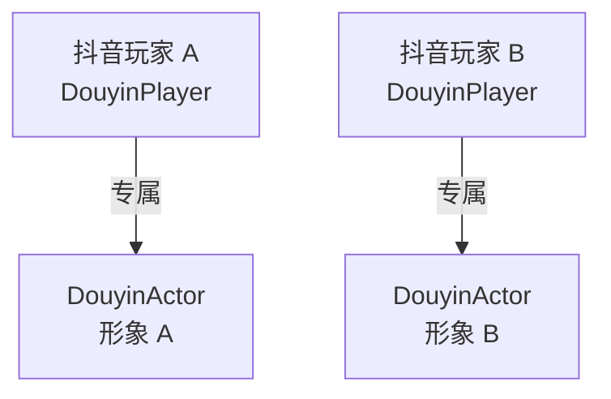

# 虚拟形象 (Avatar) 模式

在诸如**多闪仔仔世界**、Avatar 独立虚拟形象世界等场景中，玩家与显示对象的关系被定义为 **Avatar 模式**。

## 一、多闪仔仔世界与 Avatar 模式

**多闪仔仔世界**的核心体验链路是从“虚拟身份”到“虚拟空间”，再到“互动内容创作”。
- **多闪仔仔**：用户在抖音的专属「智能 3D 分身」。
- **Avatar 模式本质**：玩家与显示对象（仔仔）**一对一**，不存在两人共享一个形象，也不存在操作权在不同玩家之间转移的概念。

### 对象层级图示

---

## 二、开发原则与约束（黑名单）

由于 Avatar 模式下**不存在合养精灵**，与 Pet 相关的接口如果在 Avatar 模式中调用，业务逻辑会建立在不存在的前提上，导致逻辑不生效或严重 Bug。

因此，在 Avatar 模式（如多闪仔仔世界场景）下开发时，**必须严格禁用以下 Pet 专属 API**（C# 与 Lua 双端完全一致）：

### 1. 类级别禁用
- **`DouyinPetService`**：整个类禁止使用。
- **`DouyinPet`**：整个类禁止使用。

### 2. DouyinActor 上的禁用成员
在 Avatar 模式下访问以下属性/事件会返回默认值（`false`/`null`）或被系统拦截：
- `onGetPetMessage`（事件）：禁用，不得订阅。
- `isBindMode`（属性）：禁用，不得读取。
- `isMasterMode`（属性）：禁用（默认返回 `true`），不得依赖。
- `isObserverMode`（属性）：禁用（默认返回 `false`），不得依赖。
- `isPet`（属性）：方法警告，返回 `false`。
- `douyinPet`（属性）：方法警告，并返回 `null/nil`。

### 3. 生命周期消息禁用
- **`OnActorOperationChanged(actor)`**：禁用。由于 Avatar 模式没有控制权切换事件，该函数永远不会触发，不得声明和依赖。状态变更应由常规的 `OnPlayerJoined` / `OnPlayerLeft` 等事件承接。

---

## 三、通用入口建议

尽管两种模式存在上述差异，但它们的**通用玩家入口是一致的**：
- **玩家入口**：统一使用 `DouyinPlayerService` 与 `DouyinPlayer`。
- **Actor 入口**：统一使用 `DouyinActorService` 与 `DouyinActor`（但切记在 Avatar 模式下避开黑名单属性）。
