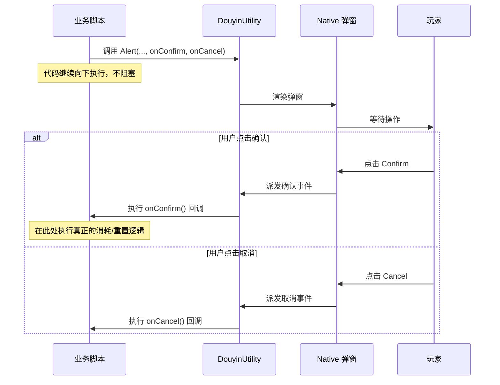

# 通用工具集
`DouyinUtility` 是平台提供的基础功能集合类。它封装了一些高频使用的轻量级交互界面（如 Toast、Alert）以及跨端通用的基础数据（如服务端时间、文本过滤）。

---


## 一、核心 API 概览
| API | 用途 | 是否有回调 |
| --- | --- | --- |
| `Toast(string msg)` | 弹出轻量级短文本提示，自动消失 | 否 |
| `Alert(title, msg, confirm, onConfirm, cancel, onCancel)` | 弹出带有双按钮的 Native 确认弹窗 | 是 |
| `GetServerTime()` / `GetServerUnixTime()` | 获取权威的服务器时间 | 否 |
| `FilteEmoji(string)` | 过滤文本中的 Emoji（防止 iOS 上显示乱码） | 否 |

---


## 二、Native Alert 时序与业务流
`Alert` 不具备同步阻塞能力，业务逻辑必须严格放在对应的 callback 闭包中执行。



---


## 三、硬约束与常见误区

1. **Alert 无返回值**：
   - 错误写法：`local ok = DouyinUtility.Alert(...) if ok then ... end`
   - 正确写法：把 `then ...` 里面的代码放到 `onConfirm` 函数中。
2. **严防高频调用**：
   - 禁止在 `Update` 等逐帧循环中触发 `Toast` 或 `Alert`。提示必须由一次性的状态变更或交互（如 Click）触发。
3. **参数顺序固定**：
   - `Alert` 的参数顺序必须严格为 `title, message, confirmText, confirmCallback, cancelText, cancelCallback`。
4. **不可撤销操作必弹窗**：
   - 对于消耗资源、重置进度等危险操作，不能仅用 `Toast` 提示结果，必须先用 `Alert` 拦截确认。


---


## 四、最佳实践 Helper
为了避免参数传错以及简化 `nil` 判断，推荐在项目公共库中封装以下 Helper：
```lua
local DouyinUtility = CS.DouyinUtility

-- 安全的 Toast，过滤空消息
local function ShowToast(message)
  if message == nil or message == "" then return end
  DouyinUtility.Toast(tostring(message))
end

-- 标准化 Alert，自动补充空回调
local function ShowConfirmAlert(title, message, confirmText, cancelText, onConfirm, onCancel)
  DouyinUtility.Alert(
    title,
    message,
    confirmText,
    function() if onConfirm ~= nil then onConfirm() end end,
    cancelText,
    function() if onCancel ~= nil then onCancel() end end
  )
end

-- 导出给其他模块
return {
    ShowToast = ShowToast,
    ShowConfirmAlert = ShowConfirmAlert
}
```

### 业务场景应用示例
在交互按钮按下时请求重置机关：
```lua
local utilityHelper = require("UtilityHelper")

function OnInteractorButtonClick(index)
  if index ~= 1 or localActor == nil then return end

  utilityHelper.ShowConfirmAlert(
    "确认重置",
    "是否重置当前机关？",
    "确认",
    "取消",
    function()
      -- 业务逻辑：确认回调
      ResetMechanism()
      utilityHelper.ShowToast("机关已重置")
    end,
    function()
      -- 业务逻辑：取消回调
      utilityHelper.ShowToast("已取消")
    end
  )
end
```
