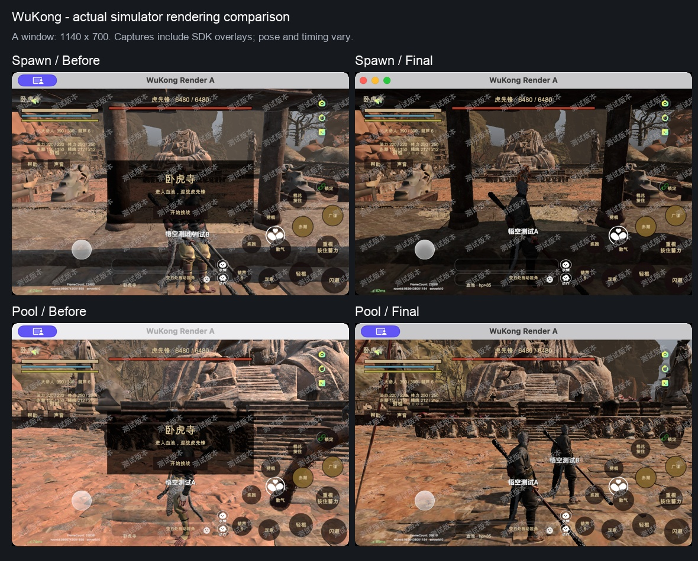

# 悟空 · 渲染还原实施记录

日期：2026-11-23。已按[确认方案](render-restoration-design.md)完成材质、光照、后处理与阴影更新，生成最终缓存并完成 DS 双端回归。整体色调和细节更接近原站，仍保留 URP 与 Three.js 的渲染差异。

## 1. 画面与改动

上述拼图来自本轮基线和环境校准阶段 A 客户端，游戏分辨率均为 1140×700；窗口截图为 570×378。它早于最后的颜色因子修正，仅用于定性对照。姿态、挑战状态和 SDK 叠层不同，不作逐像素评分。

原站参考：[出生点](reference/step3-reference-spawn-wk-arena-114152.png)、[血池](reference/step3-reference-blood-pool-wk-arena-114152.png)。

最终已保存的实际 Main Camera 截图：

- [出生点](../unity/Assets/WuKong/Evidence/render-final-spawn.png)
- [血池](../unity/Assets/WuKong/Evidence/render-final-pool.png)
- [天命人](../unity/Assets/WuKong/Evidence/render-final-wukong.png)
- [虎先锋](../unity/Assets/WuKong/Evidence/render-final-tiger.png)

四张最终 Editor 截图为 1280×720、FOV 55，保留 URP 后处理；拍摄后还原相机、目标纹理和视角。初期 `render-before-*` / `render-after-*` 与 `render-final-camera-views.jpg` 拼图保留过程证据，后者早于颜色因子修正。

最新实际运行的[出生点](reference/render-runtime-final-spawn.jpg)、[聚形散气](reference/render-runtime-final-cloud.jpg)已归档。补拍的[血池待战](file:///var/folders/t5/cx_l90z95vx72xgc8ps0j8n80000gn/T/trae/computer-use/20261123/screenshots/sdk-6b03deba236ea9d8.jpg)、[B 真实变身](file:///var/folders/t5/cx_l90z95vx72xgc8ps0j8n80000gn/T/trae/computer-use/20261123/screenshots/sdk-6b03deeb159af1e0.jpg)、[A 自然死亡](file:///var/folders/t5/cx_l90z95vx72xgc8ps0j8n80000gn/T/trae/computer-use/20261123/screenshots/sdk-6b03ded32342f270.jpg)保留于本机临时截图目录。复制这三张图及重新生成拼图的命令被工具审批拒绝，未返回具体原因，因此未重试该命令；现有归档池景 / 变身 / Boss 图仍属前一轮。近身战斗中曾短暂出现相机被模型遮满的画面，之后恢复，尚未调整这段相机避障行为。

| 内容 | 最终实现 |
| --- | --- |
| 表面 | 从 7 个原始 GLB 恢复 462 个材质，替换 3819 个 Renderer 的表面；角色与场景恢复基础色、法线、MR、AO、发光和 UV |
| 天命人 | 恢复服装、皮肤、金属、毛发的原始贴图与因子，替代此前中性法线、固定光滑度的近似 |
| 虎先锋 | 保留顶点色；毛发白色基础图依赖 `COLOR_0`，不再丢失其颜色；恢复裁切、双面和背面法线 |
| 色调映射 | 修复 `ArenaPost.asset` 的空组件引用，ACES 作为 Profile 子资源保存；重新加载后引用有效 |
| 阳光 | 保留源方向；源强度 10 按直接漫反射公式差异换算为 Unity 的 `10 / π ≈ 3.1831` |
| 环境光 | 显式三色环境光，保留源天空线性值、雾色 sRGB 语义；修复暗部过黑，避免依赖 Editor 异步天空 SH |
| 天空与反射 | 128 像素 HDR 梯度 Cubemap、8 层 mip，反射强度 0.6；可见天空仍由相机纯色背景输出 |
| 雾 | 沿用源指数平方雾与密度 0.005813 |
| 桌面 | 主光阴影 2048、50 米、两级联、4× MSAA、HDR |
| 移动配置 | 主光阴影 1024、35 米、两级联、2× MSAA、HDR；本轮未作手机实测 |
| 构建兼容 | 新增 `WuKong/Source Lit`；glTF ShaderGraph 停用 BuiltIn Target，保留 URP / HDRP，消除本轮 BuiltIn Deferred / Metal 编译阻塞 |

环境色输入先由目标线性色转为 sRGB，供 Unity 转回线性后生成环境 SH。最终 L0 为 `[0.353337, 0.387994, 0.440682]`。三色系数是本轮画面校准值，不等同于原站 HemisphereLight / PMREM 的数值。

## 2. 材质转换与持久化

入口为 `tools/prepare_render_materials.py` 和 `WuKongRenderBuilder.Apply()`（菜单 `Tools/WuKong/Restore Rendering`）。独立装配只更新七个模型表面和环境，保留现有 HUD。Arena / Skills Builder 的对应装配入口复用它。

- 7 个资源分别建立清单，记录源 GLB SHA-256；以材质序号保存资产，按原模型 Renderer 路径和材质名对应，避免跨模型同名冲突。
- glTF 的 MR 使用 **B 金属度、G 粗糙度**；转换为 URP 的 **R 金属度、A 光滑度**，合并源因子并限制到有效范围。源 AO 的 R 通道转到 URP 的 G 通道。
- 保留 glTFast 翻转 V 后的 UV 语义：`offsetY = 1 - sourceOffsetY - scaleY`。当前源贴图均满足共享 UV 变换；不支持的独立旋转或第二 UV 会明确拒绝转换。
- 基础色 / 发光为 sRGB，MR / AO 为线性，法线使用 NormalMap 导入；保留原透明模式、阈值、双面配置。关闭 `alphaIsTransparency`，避免不透明贴图 Alpha 为零时丢失有效 RGB。
- glTF 颜色因子为线性；写入 ShaderLab Color 属性前转换为 sRGB，避免 Unity 上传时再次压暗。浮点目标实测输入 0.5 得到线性 0.214；修正后全部 462 个基础色因子反向核验通过。
- 导出 1280 张独立 PNG；原始 GLB、动画和几何保留。全图像素及透明 / 双面元数据核对 **462/462**，见[材质证据](reference/render-material-data-evidence.json)。
- 新 Shader 使用 URP PBR，补充顶点色与双面法线，复用 Lit 的阴影、深度与 Meta Pass。当前工程 Metal 构建包含 224 个程序；最终 Shader 消息为空。

重新加载已保存场景后：462/462 材质使用 Source Lit，ACES 引用有效、场景未脏、桌面管线参数正确。见[Editor 核验](reference/render-editor-evidence.json)。最终 Console 查询返回 0 条 error；这不代表既有 SDK 退出问题已经修复。

## 3. 最终构建与实际回归

最终缓存更新时间为 **2026-11-23 14:28:44 +08:00**，位置：

`unity/AddressableAssetsData/StandaloneOSX/WuKongTiger/OSX/addrsettingcache/`

catalog SHA-256：

`e843a280a8bee055da1594546daac6a2b8719b0cca564b558547e3e3b89ee756`

实际资源包合计 **1,026,311,087 字节，约 978.77 MiB**，逐文件哈希见[交付证据](reference/render-restoration-evidence.json)。首轮 Tools/ScenePackage 调用期间 MCP 超时，但实际构建继续；颜色修正后再次构建，以更新后的缓存和实际客户端加载作为完成依据。

最终会话为 `hamlet-simulator-b2bl7yss`，原始日志：

`/var/folders/t5/cx_l90z95vx72xgc8ps0j8n80000gn/T/hamlet-simulator-b2bl7yss/`

| 用例 | 实际结果 |
| --- | --- |
| DS 与两端加载 | 服务端 22955、A 22972、B 23019 加载最终缓存；实际画面材质正常 |
| 路线 | A 按 T 完成出生点、通道、台阶、入口、血池五个路径点，记录 `reason=completed` |
| 固定用例 | **77/77** 通过 |
| F5 技能 | 立棍 / 戳棍蓄力、棍花、定身、聚形散气与破隐、广智、精魄、死亡 / 重试，回放完成 |
| F6 Boss | 远近决策、五个血量阶段、投射物、石化 / 隐身、防御、轻重棍致死 / 重试，回放完成 |
| 材质切换 | 广智、聚形散气、石化和死亡在实际回放执行，重试后天命人原材质恢复；最新变身截图见上方临时链接 |
| 真实输入 | A 实际 Enter 开始 / 重试，键盘 2 消耗法力进入聚形散气；B 键盘 4 实际变身；[透明状态截图](reference/render-runtime-final-cloud.jpg) |
| 双端状态 | 两端收到 **129 条完整内容相同的快照**；其各自挑战继续独立 |
| 正常退出 | A / B Command-Q，DS 收到两个 `ExitRoom`；本轮三个进程全部退出 |
| 日志 | 项目 Lua 异常 0；两个客户端各保留既有 SDK `GamePlayEntry Shutdown` 空引用 |

[完整运行数据](reference/render-final-runtime-evidence.json)的整体 `pass=false` 来自上述 SDK 关闭异常；固定用例、回放与项目 Lua 结果独立记录，未将其误标为全部无错误。

## 4. 性能对照

取 A 客户端 **1140×700、同一 F5 回放期间、fight 状态的五秒样本**，每轮 14 个。最终会话额外执行 B 的 F6，基线 B 未回放，回放排程与负载条件仍有差异。

| 指标 | 本轮基线 | 最终 |
| --- | ---: | ---: |
| FPS 均值 | 57.22 | 57.44 |
| 最低五秒区间 FPS | 56.69 | 56.74 |
| 帧时间 P95 最大 | 17.591 ms | 17.583 ms |
| Unity 分配内存峰值 | 1381.02 MiB | 1074.36 MiB |

帧率基本持平，未声称帧率提升。此处内存为 Unity 采样的 allocatedBytes，不是进程 RSS 或显存。统计代码、原始样本与筛选条件见[交付证据](reference/render-restoration-evidence.json)。

基线汇总工具在后续一次构建后运行，其 `catalogBuiltAt` 指向后续缓存时间；不将该字段作为基线构建时间。基线日志和截图来自旧材质客户端，比较使用其 F5 区间样本。

## 5. 使用与边界

复用本轮实现时：

1. 运行 `python3 tools/prepare_render_materials.py`。
2. 在 Unity 打开已保存的 `WuKongTiger.unity`，等待导入完成，通过 unity-mcp 执行 `Tools/WuKong/Restore Rendering`。
3. 执行 `Tools/ScenePackage`，按项目[调试技能](../.trae/skills/hamlet-debugging/SKILL.md)核验缓存后启动。
4. 使用 `tools/audit_render_editor.py`、`tools/record_presentation_evidence.py` 和 `tools/record_render_evidence.py` 记录当前状态；对照图由 `tools/make_render_comparison.py` 生成。

本轮保留的差异：

- URP ACES、反射预滤波、阴影和源 Three.js 仍有差异；三色环境光是源 Hemisphere / 环境漫反射的近似，未逐像素还原 PMREM。
- 毛发使用源卡片和裁切，未新增动态毛发 / 溶解。血池恢复原表面贴图与材质数据，未新增水面折射或液体模拟。
- 现有技能专用材质、粒子和 UI 保留；当前声音 / 特效未映射计数与既有 SDK 退出异常仍存在。
- 桌面回放、构建和截图已完成；目标手机画质 / 性能、触摸与无辅助自然完整通关仍未验收。
- glTFast 为工程内嵌包，本轮停用 BuiltIn Target 的改动需随工程保留，升级包时应重新验证。

停止本轮运行器与最后检查时，沙箱将调试器临时缓存 `unity/DouyinWorldDebuggerEditor/Cache/unityCache/` 及其 `Photograph`、`Video`，以及 `.git/index`、`.git/index.lock`、`tools/__pycache__/run_sample.cpython-314.pyc` 移入废纸篓。Git 索引需要手动恢复：在 Finder 打开废纸篓，先检查 `sboxbackup`，再将索引拖回 `/Users/bytedance/Documents/aireverse/WuKong/.git/index`；需要保留的缓存同样拖回各自原路径。本轮未访问或自动恢复废纸篓内容。

未提交 Git。项目通用规则继续以[任务计划](plan.md)引用的技能与偏好为单一事实来源。
